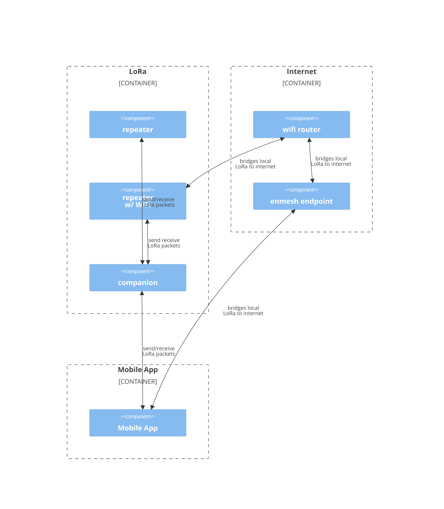

# Enmesh
Enmesh is a Rust implementation of LoRa mesh protocols.
It supports Meshtastic and MeshCore.

Enmesh has three goals:
1. Give every user transmit access to a busy mesh.
2. Support Meshtastic and MeshCore on the same hardware.
3. Bridge local LoRa traffic over WiFi and the internet.

## Quick Look
* [Run the firmware UX demonstration](./firmware/enmesh/README.md) on your computer. You do not need hardware.
* [Open the visualization](https://redengin.github.io/enmesh/) of congestion and shard formation.

# Getting Started

## Clone
```sh
git clone git@github.com:redengin/enmesh.git
cd enmesh
```

## Dependencies
* [Rust](https://rustup.rs)
* SDL2 development library: `sudo apt install libsdl2-dev`
* [Espressif Rust toolchain](https://docs.espressif.com/projects/rust/book/getting-started/tooling/index.html)

## Build and test the host crates
```sh
cargo build --workspace
cargo test --workspace --features reticulum/std
```

## Build the firmware
The firmware is not in the workspace.
Replace `<platform name>` with a feature name from the board `Cargo.toml`, for example `wireless_paper`.

```sh
cd firmware/boards/heltec_esp32
cargo build --release --features="<platform name>"
```
To flash a board, see the [flashing instructions](./firmware/boards/README.md).

# Supported Boards
| Board | LoRa | BLE | WiFi | GPS | Sensors |
|---|---|---|---|---|---|
| [Heltec WiFi LoRa 32 v3](https://heltec.org/project/wifi-lora-32-v3/) | In-Work | Tested | In-Work | TODO | TODO |
| [Heltec WiFi LoRa 32 v4](https://heltec.org/project/wifi-lora-32-v4/) | In-Work | Tested | In-Work | TODO | TODO |
| [Heltec Wireless Stick v2](https://heltec.org/project/wireless-stick-lite-v2/) | In-Work | Not Tested | Not Tested | TODO | TODO |
| [Heltec Wireless Stick v3](https://heltec.org/project/wireless-stick-lite-v3/) | Incomplete | Not Tested | In-Work | TODO | TODO |
| [Heltec Wireless Tracker](https://heltec.org/project/wireless-tracker/) | In-Work | Not Tested | In-Work | TODO | TODO |
| [Heltec Wireless Paper](https://heltec.org/project/wireless-paper/) | In-Work | Tested | In-Work | TODO | TODO |

Enmesh needs a small board support layer for each platform. Other platforms (nRF52 and others) need this layer.

# How Enmesh Works
Mesh LoRa separates the spread of data from the meaning of data.
Current LoRa mesh implementations spread data at the same speed or slower.

Enmesh manages the LoRa radio to keep transmit access to the mesh.
It supports the Meshtastic and MeshCore protocols.
* [Congestion mitigation](./docs/congestion.md)
* [Design](./docs/design.md)

## Mesh LoRa RFCs
The RFC drafts are in the wiki.
* [RFC process](https://github.com/redengin/enmesh/wiki/RFC-Process)
* [Mesh LoRa Anonymity](https://github.com/redengin/enmesh/wiki/RFC-%E2%80%90-Mesh-LoRa-Anonymity)
* [Mesh LoRa Network Protocol](https://github.com/redengin/enmesh/wiki/RFC-%E2%80%90-Mesh-LoRa-Network-Protocol)
* [Mesh LoRa RF Protocol](https://github.com/redengin/enmesh/wiki/RFC-%E2%80%90-Mesh-LoRa-RF-Protocol)

## WiFi Bridges
Enmesh firmware supports [MQTT](https://en.wikipedia.org/wiki/MQTT) as a bridge over [WiFi](https://en.wikipedia.org/wiki/Wi-Fi).
This supports services like [letsmesh.net](https://letsmesh.net).

# Repository Overview
* [firmware](firmware) - board support for common hardware
  * [boards](firmware/boards) - flashable implementations of Enmesh
  * [soc/*](firmware/soc) - Rust HALs for LoRa platforms
  * [common](firmware/common) - shared Rust crates used by Enmesh
  * [enmesh](firmware/enmesh) - board-agnostic implementation of Enmesh
* [Meshtastic library](Meshtastic) - Rust implementation of Meshtastic
  * IN-WORK: Meshtastic changes quickly. This should become a separate repo.
* [MeshCore library](MeshCore) - Rust implementation of MeshCore
  * IN-WORK: MeshCore changes quickly. This should become a separate repo.
* [docs](docs) - design and congestion notes
* [simulation](simulation) - browser model of congestion and shards

## Enmesh Physical Architecture


Enmesh BLE supports mobile apps that use the Meshtastic or MeshCore BLE services.
An Enmesh mobile app is planned.
It will use an Enmesh BLE service for more control.
